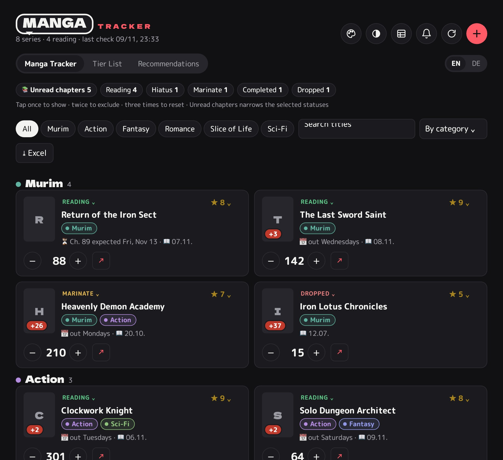

# Manga Tracker

[Deutsch](README.md) | **English**

A small app to keep track of manga, manhwa and manhua: reading progress, ratings, new chapters, release days, a tier list and recommendations.

- **App:** https://lobi1994.github.io/Manga-Tracker/
- **Set up your own tracker:** [SETUP.md](SETUP.md)

## How it works

- Each user's data lives in **their own Google Sheet**. An Apps Script inside that sheet provides a small web app.
- The interface (`index.html`) is hosted here on GitHub Pages and is the same for everyone. The first time you open it, you enter your personal setup link; the app link and key are stored only on your own device.
- iOS Shortcuts log the chapters you read straight from Safari.

## Files

| Path | Contents |
|---|---|
| `index.html` | App page for GitHub Pages (generated, do not edit directly) |
| `google/MangaTracker-Vorlage.gs` | The complete script in one file, to paste into a new sheet |
| `google/*.gs`, `google/Index.html` | The individual source files |
| `kurzbefehle/kapitel-aktualisieren.js` | JavaScript for the "Kapitel aktualisieren" (update chapter) shortcut |
| `userscript/manga-tracker.user.js` | Overlay for Safari ("Userscripts" app): shows where you stopped, saves chapters automatically and adds manga ideas from Instagram |
| `icons/` | App icons |
| `tools/build.py`, `tools/setup.html` | Build `index.html` and the template from the source files |

Build: `python3 tools/build.py <folder with the Apps Script files>`
